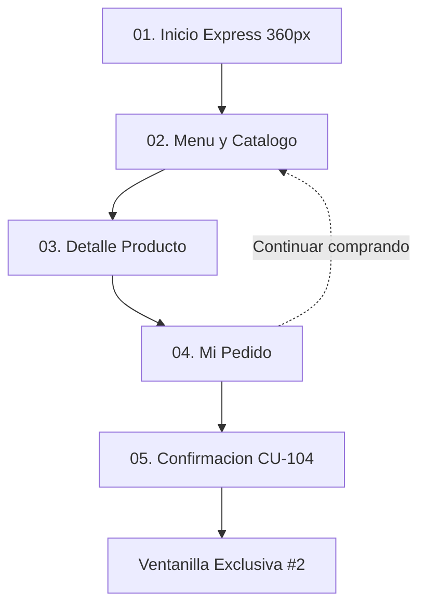
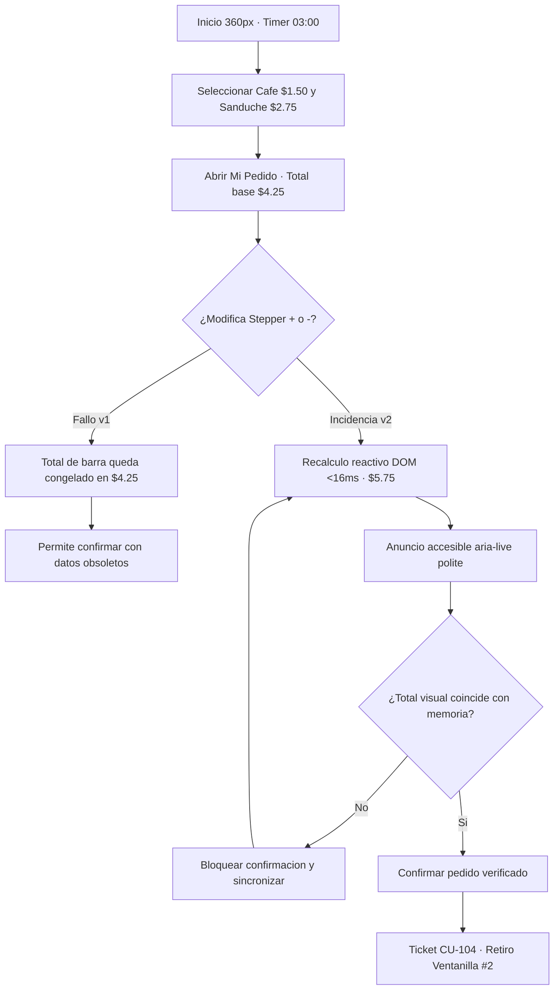

# IHC-A-01 · Diagramas

## Sitemap

El sitemap representa la arquitectura del flujo móvil express de CaféU adaptada a una resolución base de 360 px. Permite la navegación lineal ágil entre el menú, la selección de productos y la revisión del carrito antes de emitir la orden bajo el límite de 3 minutos.

## User flow

El user flow modela el recorrido transaccional, diferenciando la rama de error original (desincronización de total en v1) de la rama corregida con recálculo reactivo automático en menos de 16 ms y bloqueo preventivo de importes desactualizados.

