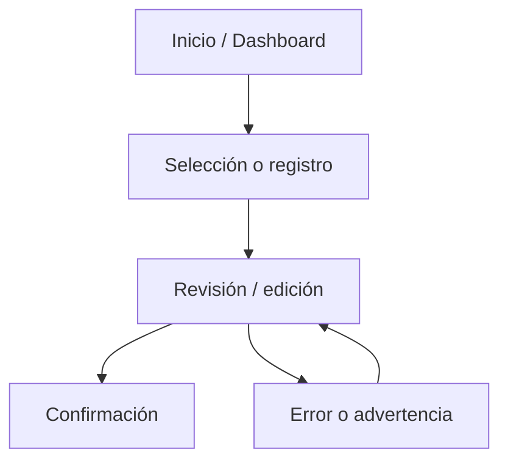
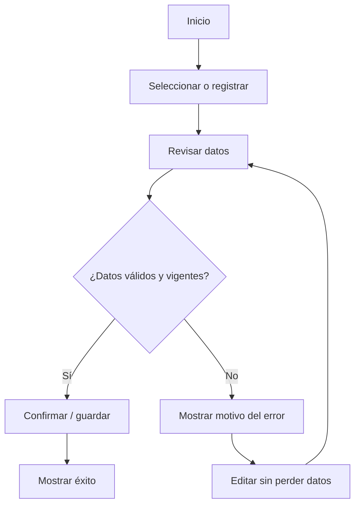

# IHC-A-01 — Diagramas

### Sitemap propuesto 

### User flow principal y rama de error/edición 

**Recorrido principal:** Inicio → Menú → Agregar café y sánduche → Mi pedido → Revisar total → Confirmar → Pedido recibido.

**Recorrido de edición o error:** Mi pedido → Modificar cantidad → Recalcular subtotales y total → Anunciar nuevo importe → Revisar nuevamente → Confirmar solo si el total coincide.

