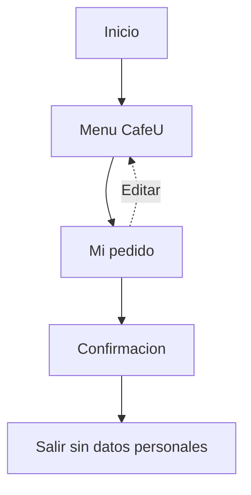
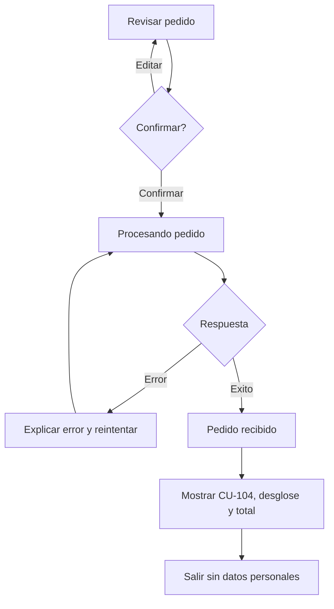

# IHC-A-03 · Diagramas

## Sitemap

El sitemap representa el recorrido mínimo de CaféU desde el inicio hasta la confirmación. La persona puede revisar o editar el pedido antes de llegar al estado recibido.

## User flow

El flujo diferencia revisar, procesar, fallar y confirmar. La pantalla «Pedido recibido» solo aparece después de una respuesta exitosa, evitando confundir el clic con la recepción real.

