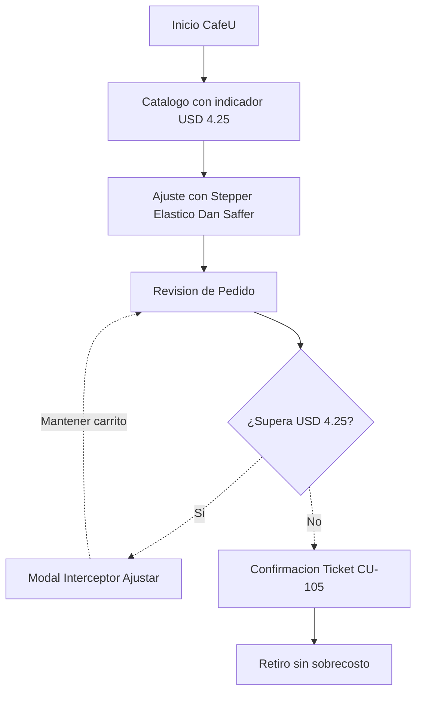
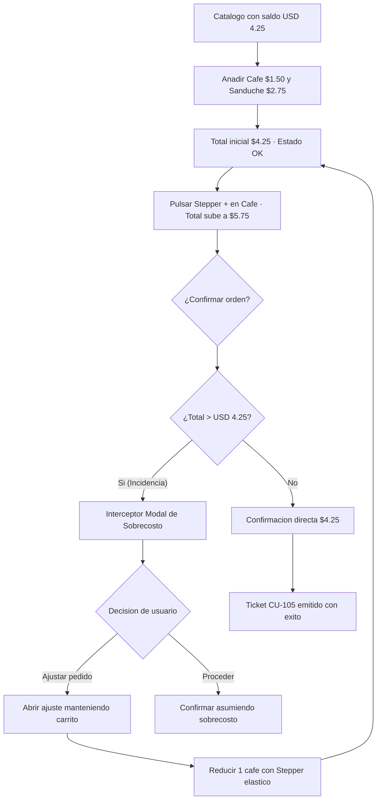

# IHC-A-05 · Diagramas

## Sitemap

El sitemap organiza el catálogo y el carrito de CaféU incorporando la monitorización activa del umbral presupuestario de USD 4,25.

## User flow

El flujo define el control de presupuesto. Si la suma de productos sobrepasa los USD 4,25, el sistema activa una alerta visual y despliega un diálogo preventivo antes de confirmar, facilitando el ajuste de porciones sin reiniciar la compra.

