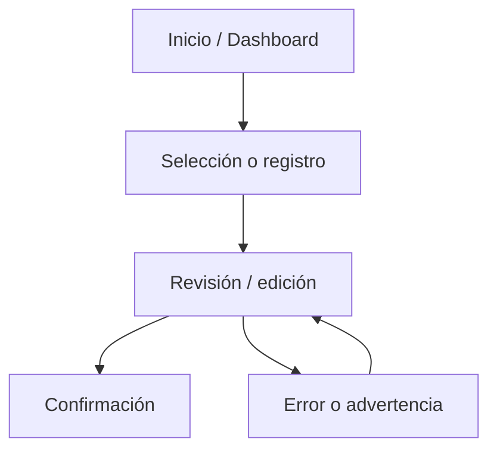
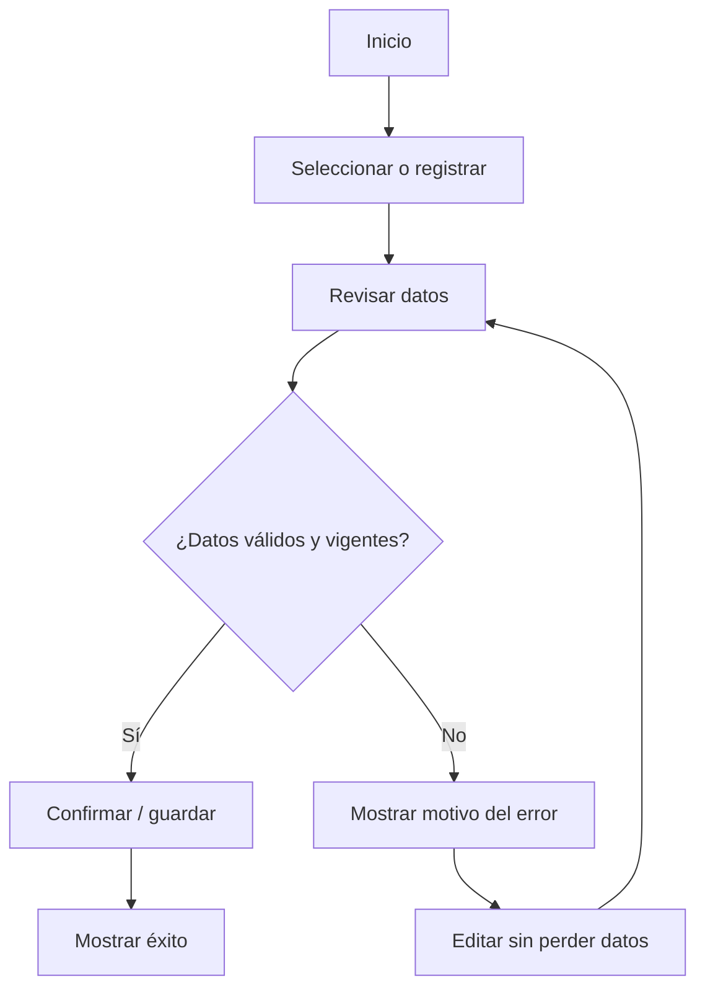

# IHC-A-05 — Diagramas

### Sitemap propuesto 

### User flow principal y rama de error/edición 
**Recorrido principal:** Menú → Agregar productos → Revisar total → Total ≤ $4,25 → Confirmar → Pedido recibido.

**Recorrido de edición o error:** Carrito → Aumentar cantidad → Total > $4,25 → Mostrar exceso y advertencia → Ajustar sin vaciar carrito → Recalcular y volver a revisar.

