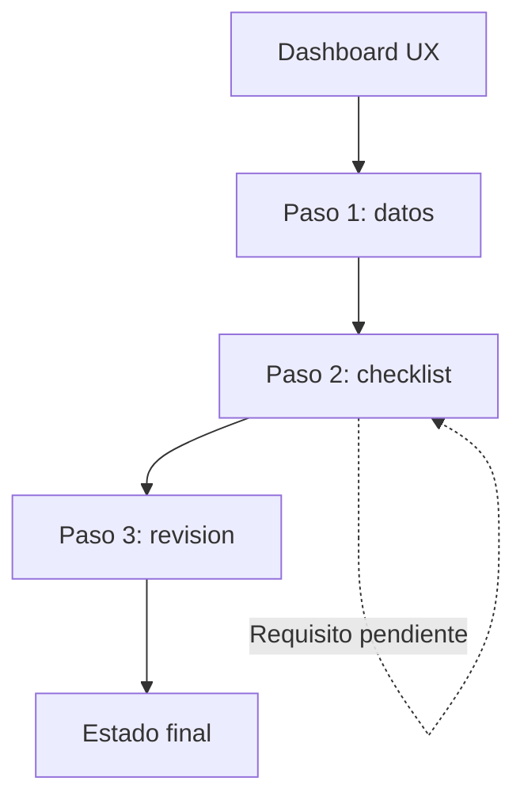
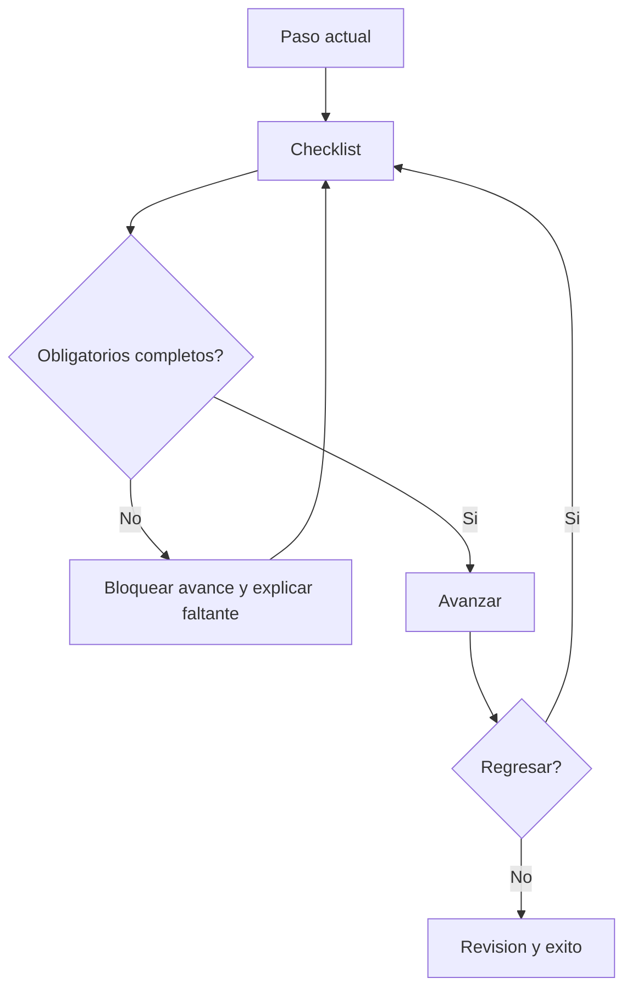

# IHC-A-07 · Diagramas

## Sitemap

El sitemap organiza el Dashboard en etapas secuenciales. El checklist controla el acceso a la revisión y al estado final.

## User flow

El flujo valida los requisitos antes de avanzar. Si existe un pendiente, se explica el bloqueo; al regresar, las marcas se conservan.

