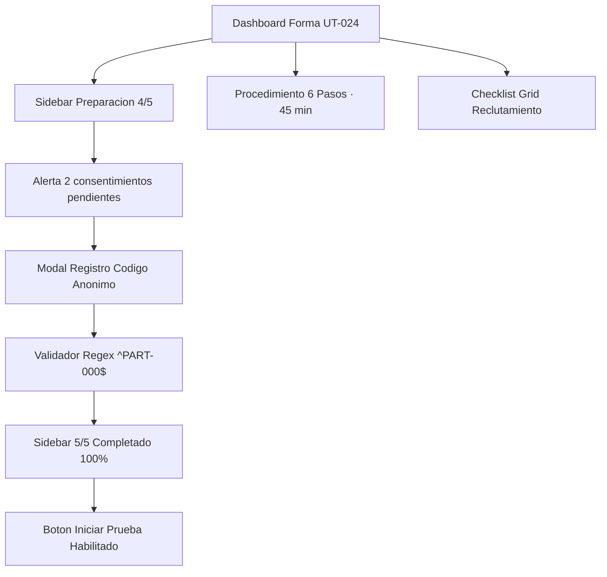

# IHC-A-09 · Diagramas

## Sitemap

El sitemap describe la navegación del Dashboard de Plan de Pruebas "Forma" (Estudio `UT-024`), estructurado en barra lateral de preparación ética y área de procedimiento de 6 pasos.



## User flow

El flujo modela la validación de seudónimos requerida para el consentimiento. Si el usuario ingresa texto libre o nombres reales, el motor regex bloquea la confirmación; al ingresar códigos válidos (`PART-004` y `PART-005`), el estudio queda 100% preparado.

```mermaid
flowchart TD
  A[Dashboard Forma · Alerta en Sidebar] --> B[Abrir Modal de Registro Seudonimo]
  B --> C[Ingresar Codigo de Participante]
  C --> D{¿Cumple Regex ^PART-[0-9]{3}$?}
  D -- No (Texto libre / Nombres) --> E[Error inline: No se admiten nombres personales]
  E --> B
  D -- Si (PART-XXX) --> F[Checkmark verde y boton habilitado]
  F --> G[Guardar consentimiento firmado digitalmente]
  G --> H[Actualizar contador lateral: 4/5 a 5/5 listos]
  H --> I[Alerta resuelta y checklist marcado como Completado]
  I --> J[Boton Iniciar Prueba activo y navegable]
```
