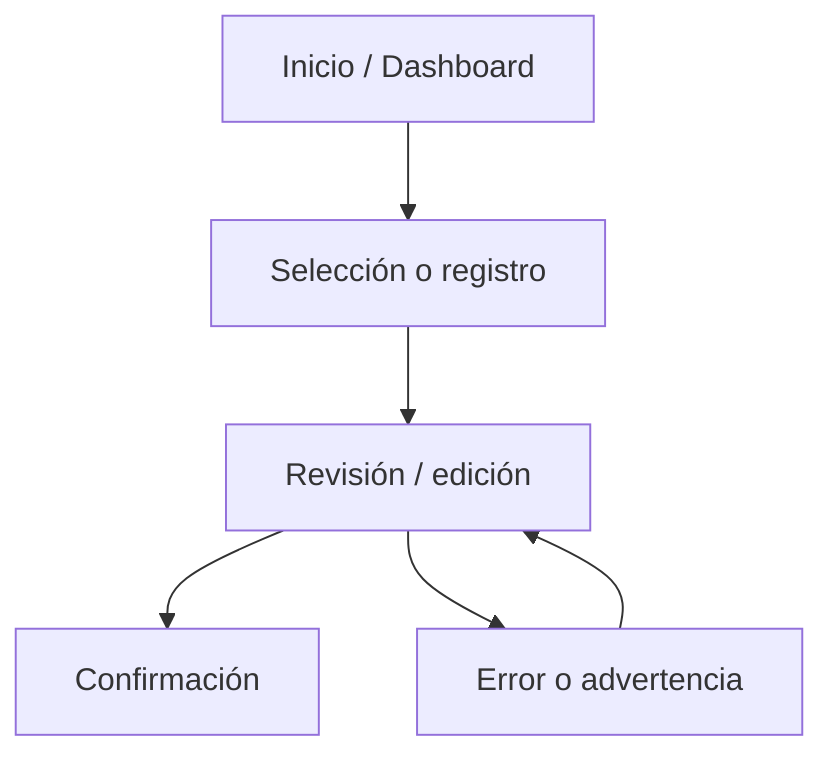
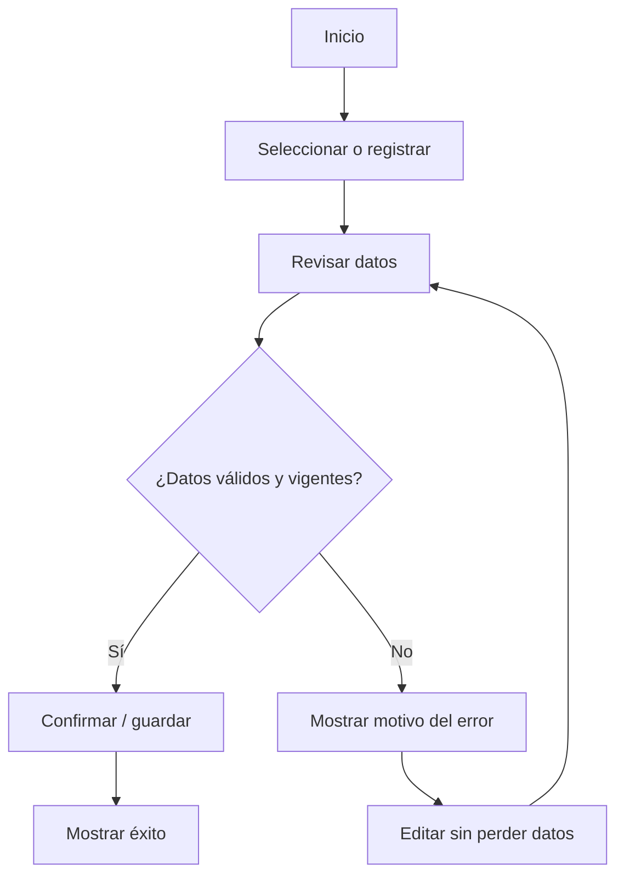

# IHC-A-09 — Diagramas

### Sitemap propuesto 

### User flow principal y rama de error/edición 

**Recorrido principal:** Dashboard → Nueva sesión → Ingresar P-001 → Registrar resultados → Validar código → Guardar → Confirmación.

**Recorrido de edición o error:** Formulario → Código vacío o incorrecto → Mostrar error de formato → Corregir código → Conservar resultados → Validar y guardar.

