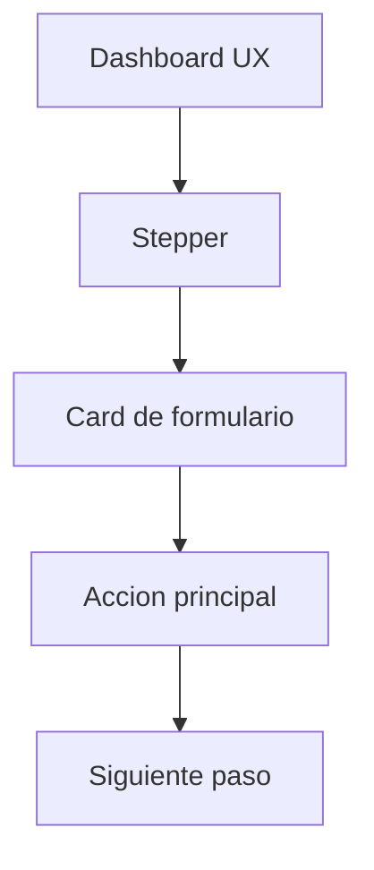
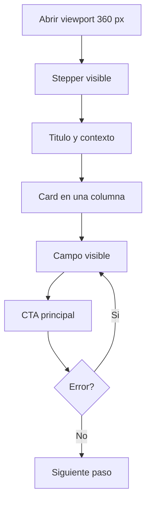

# IHC-A-11 · Diagramas

## Sitemap

El sitemap conserva el orden lógico en un viewport de 360 px: primero el Stepper, luego el contenido de la Card y finalmente la acción principal.

## User flow

El flujo responsive mantiene una columna y permite regresar al campo si existe un error, sin ocultar el contenido ni romper el orden del foco.

