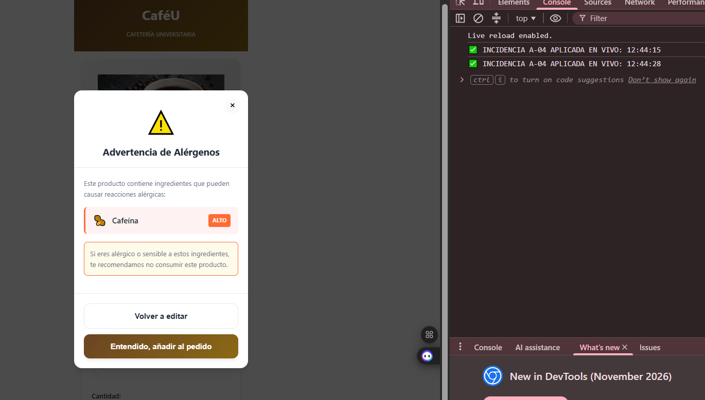
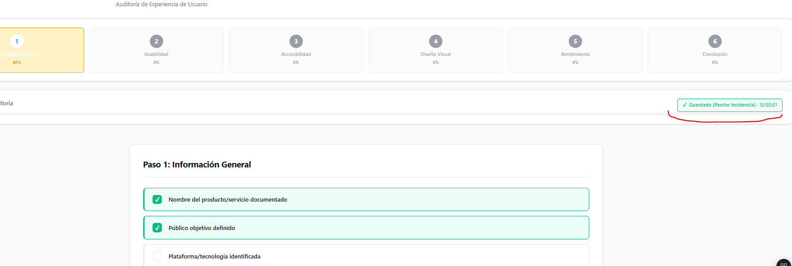

# Incidencias Sorpresa · IHC-A-04 e IHC-A-08

**Universidad Técnica de Ambato · FISEI · Carrera de Software**
**Asignatura:** Interacción Humano-Computadora (IHC)
**Paralelo:** A
**Responsable:** Sebastián (@SebasIsd)
**Fecha:** 29 de octubre de 2026

## 🚨 IHC-A-04 · Alergia añadida

###  Evento imprevisto
El producto seleccionado contiene un **alérgeno no visible en el detalle**. El usuario podría confirmar el pedido sin conocer el riesgo, lo que representa un problema de salud y de usabilidad crítica.

### ✅ Cambio obligatorio aplicado
- Mostrar el ingrediente/alerta **antes de confirmar** el pedido.
- Ofrecer al usuario la opción de **volver al detalle sin vaciar el carrito**.
- Implementar confirmación explícita mediante checkbox ("Entiendo los riesgos").
- Preservar el estado del carrito al regresar al flujo de edición.

### 📸 Evidencias requeridas
- Captura del modal de alérgenos con el checkbox de confirmación visible.
- Captura del carrito intacto tras usar el botón "Volver a editar".
- Rama de edición en el user flow actualizada.
- Prueba de comprensión con usuario externo (Registro P-04).
- Commit posterior al anuncio de la incidencia.

###  Pregunta de defensa
> **¿Cómo prueba que el usuario comprende y puede corregir su elección?**

**Respuesta:**  
La comprensión se valida mediante un **checkbox de confirmación explícita** ("Entiendo los riesgos") que bloquea el botón de añadir hasta ser marcado. Si el usuario duda, el botón **"Volver al detalle"** preserva el estado del carrito en memoria (no lo vacía), permitiéndole corregir su elección sin perder su progreso. La evidencia observable es la persistencia del ítem en el carrito tras cerrar el modal, combinada con el feedback visual (animación *shake* si intenta avanzar sin confirmar).

---

##  IHC-A-08 · Guardado inconsistente

### 🔴 Evento imprevisto
El usuario marca tres casillas del checklist, cambia de etapa en el Stepper y, al volver, **las casillas aparecen desmarcadas**. Esto genera pérdida de trabajo, frustración y desconfianza en el sistema.

### ✅ Cambio obligatorio aplicado
- **Conservar los valores** marcados usando `localStorage`.
- **Informar el estado de guardado** mediante un badge con timestamp ("Guardado · 10:45:30").
- **Diferenciar visualmente** entre estado *pendiente* (borde gris) y *completo* (borde verde con check).
- Mostrar el **porcentaje de progreso real** por cada paso del Stepper.

###  Evidencias requeridas
- Captura **antes/después** de la navegación entre pasos.
- Prueba de retorno mostrando persistencia de las marcas.
- Badge de "Guardado" con hora visible.
- Revisión y aprobación de PR por compañero.
- Commit posterior al anuncio.

### 🎯 Pregunta de defensa
> **¿Qué evidencia muestra una mejora real frente a una mejora inferida?**

**Respuesta:**  
La evidencia de **mejora real** es la persistencia observable en el `localStorage` (inspeccionable en DevTools) y el badge de "Guardado · [hora]" que aparece inmediatamente al marcar una casilla. No es una mejora *inferida* porque el usuario **ve el feedback visual** (borde verde, check, timestamp) y, al cambiar de paso, el estado se restaura exactamente, eliminando la carga cognitiva de recordar qué marcó. Una mejora inferida sería solo cambiar el color del checkbox sin guardar realmente el dato.

